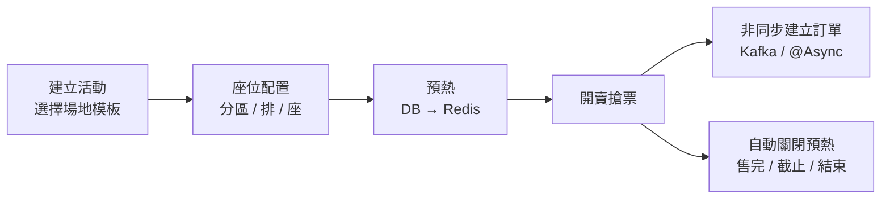

<div align="center">

# 🍰 HolidayDessert（假日甜點）

以 Spring Boot 3 打造的甜點電商暨會員票券管理系統，包含前台購物網站與後台管理系統，並整合訊息佇列，並整合 Redis、Kafka、WebSocket、全文搜尋、AI 與 OCR 等周邊服務。

[](https://openjdk.org/)
[](https://spring.io/projects/spring-boot)
[](https://www.mysql.com/)
[](https://redis.io/)
[](https://kafka.apache.org/)
[](https://www.docker.com/)
[](.github/workflows/ci.yml)

🔗 前台 Vue 3 版本：[holiday_dessert_vue](https://github.com/AnthonyFuFu/holiday_dessert_vue)

</div>

---

## 📑 目錄

- 📖 專案簡介
- 🛠 技術棧
- 🧩 功能模組
- 🎫 搶票系統
- 💬 即時客服聊天室
- 📂 專案結構
- ✅ 環境需求
- ⚙️ 設定檔
- 🚀 啟動方式
- 🐳 Docker 部署與 CI
- 📘 API 文件
- 🔗 測試網址

---

## 📖 專案簡介

HolidayDessert 是一套以甜點電商為情境的全端練習／實戰專案，涵蓋：

- 🛍️ **前台（front）**：商品瀏覽、購物車、下單結帳、會員註冊登入（含 Google OAuth2）、優惠券、行銷活動、即時客服聊天室、最新消息與留言互動。
- 🗂️ **後台（admin）**：營運儀表板、員工／部門、商品、訂單、會員、優惠券／促銷活動、行事曆、公司資訊、最新消息與票務活動管理。
- 🎫 **搶票系統**：場地模板自動產生分區與座位、Redis 預熱、四層防護高併發搶票、電腦自動配位、Kafka 非同步建立訂單，並內建後台壓力測試工具。
- 🔌 **周邊整合**：OpenSearch 全文搜尋、AWS S3 分片上傳、Azure OpenAI（文字生成／圖像辨識）、Tesseract OCR、PDF／Excel 報表產製、Jasypt 敏感資料加解密。

---

## 🛠 技術棧

| 分類 | 技術 |
| --- | --- |
| 🧑‍💻 語言／框架 | Java 17、Spring Boot 3.5.16 |
| 🌐 Web／模板 | Spring MVC、Thymeleaf、WebSocket（STOMP + SockJS） |
| 🗄️ 資料存取 | Spring Data JPA、Spring JDBC、MySQL 8 / MariaDB、HikariCP |
| ⚡ 快取／訊息 | Redis（Lua Script、分散式鎖）、Apache Kafka、Confluent Avro Serializer |
| 🧵 併發控制 | JUC（`Semaphore`、`AtomicInteger`、`ConcurrentHashMap`）、`@Async` 執行緒池 |
| 🔍 搜尋引擎 | OpenSearch（搭配 Logstash 同步 `index_member`） |
| ☁️ 雲端儲存 | AWS SDK v2（S3 Multipart Upload） |
| 🔐 安全性 | Spring Security、JWT（`jjwt` / `java-jwt`）、OAuth2 Client（Google 登入）、Jasypt |
| 🤖 AI／影像 | Azure OpenAI（Chat）、Azure AI Vision（Image Analysis）、Tess4J（OCR） |
| 📄 文件產製 | iTextPDF、Apache POI、JExcelAPI |
| 📘 API 文件 | springdoc-openapi（Swagger UI） |
| 🧰 建置／部署 | Maven（`mvnw`）、Docker / Docker Compose、GitHub Actions、GHCR |

---

## 🧩 功能模組

### 🛍️ 前台（`controller` / `templates/front`）
- 首頁、商品與活動展示（`IndexController`、`HolidayDessertController`）
- 會員登入註冊、Google 第三方登入（`FrontLoginController`、`MemberController`）
- 收藏清單（`CollectionController`）
- 表單／留言（`FormController`）
- 即時客服聊天室（`ChatRoomController`，WebSocket）
- 搶票 API（`TicketController`）
- 公司資訊、通用 CRUD 查詢（`CompanyInformationController`、`CRUDController`）

### 🗂️ 後台（`controller/admin`）
- 營運儀表板：營收與成長率、近 30 天營收趨勢、訂單狀態、熱銷商品、會員、排班、票務售出率（`IndexManagement`、`DashboardService`）
- 員工／部門管理（`EmployeeManagement`）
- 商品管理（`ProductManagement`）
- 訂單管理（`OrderManagement`）
- 會員管理與客服聊天（`MemberManagement`）
- 優惠券／促銷活動管理（`CouponManagement`、`PromotionManagement`）
- 行事曆（`CalendarManagement`）
- 最新消息（`NewsManagement`）
- 票務活動管理、座位配置、搶票測試（`TicketManagement`）
- 公司資訊管理（`CompanyManagement`）
- 後台登入（`LoginController`）

### 🧰 其他能力
- AWS S3 分片上傳與檔案切片轉送（`S3Controller`）
- OCR 文字辨識（`OcrController`，Tess4J + tessdata）
- PDF 產生／下載（`PdfController`，iTextPDF）
- Azure OpenAI 聊天與圖像分析（`OpenAIController`）
- OpenSearch 查詢（`OpenSearchController`）
- JWT 簽發與驗證（`TokenController`）
- Jasypt 加解密工具（`JasyptController`）
- 高併發練習端點（`HighConcurrencyController`）
- 排程任務（`schedule/RunSchedule`、`schedule/TicketWarmUpSchedule`）

---

## 🎫 搶票系統

模擬演唱會開賣的瞬間高併發情境：先把票務資料預熱到 Redis，搶票時只操作 Redis，訂單再非同步寫回資料庫。

### 🔄 活動生命週期



| 階段 | 說明 |
| --- | --- |
| 🏟️ 場地模板 | `TicketVenue` 內建「台北大巨蛋」「台北小巨蛋」與「自訂場地」，選擇後自動產生各分區（票種）、票價、排數與座位數 |
| 🪑 座位配置 | 後台座位圖可新增、修改、刪除分區；分區異動後會清除該票種快取，需重新預熱 |
| 🔥 預熱 | 以 Redis 分散式鎖防止重複初始化，將票種資訊、剩餘票數、座位池寫入 Redis（TTL 24 小時）；已在搶票中的 Key 不會被覆蓋 |
| ⏹️ 自動關閉 | `TicketWarmUpSchedule` 每分鐘檢查，票種全部售完、超過售票時間、活動結束或取消時自動關閉預熱 |
| 🧪 測試工具 | 後台可一鍵模擬最多 2,000 名會員同時搶票，回報成功、售罄、超過上限、系統繁忙等各類結果的人數，以及售出張數、耗時與 TPS；也可重置活動（刪訂單 → 還原庫存 → 清 Redis → 重新預熱） |

### 🛡️ 四層防護

```mermaid
flowchart TD
    R([搶票請求]) --> L1{Layer 1<br/>Semaphore 流控}
    L1 -- 超過 200 併發 --> X1[系統繁忙]
    L1 --> L2{Layer 2<br/>本地計數器}
    L2 -- 本地已售罄 --> X2[票已售罄]
    L2 --> L3{Layer 3<br/>Redis Lua 原子操作}
    L3 -- 票數不足 --> X2
    L3 -- 超過個人上限 --> X3[超過購買上限]
    L3 -- 扣票 + 配位成功 --> L4[Layer 4<br/>非同步寫入 DB]
    L4 --> K[(Kafka)]
    L4 -. 未啟用 kafka profile .-> A[(@Async 執行緒池)]
```

| 層級 | 技術 | 目的 |
| --- | --- | --- |
| Layer 1 | `Semaphore(200)` | 限制同時進入 Redis 的請求數，保護下游 |
| Layer 2 | `ConcurrentHashMap<typeId, AtomicInteger>` | 本地剩餘數，售罄後直接在 JVM 內攔截，不再打 Redis |
| Layer 3 | Redis Lua Script | 一次原子完成「檢查剩餘數 → 檢查個人上限 → 扣票 → 依前排優先、同排連號配位」，杜絕超賣 |
| Layer 4 | Kafka / `@Async` | 訂單非同步落地；DB 端以條件式 UPDATE 再次防止超賣，失敗時記錄補償日誌 |

> 訂單建立後狀態為「待付款」，付款期限 15 分鐘，金額以搶票當下的票價快照計算。

### 🗝️ Redis Key 設計

| Key | 型別 | 內容 |
| --- | --- | --- |
| `ticket:type:info:{typeId}` | Hash | 票種名稱、票價、每人上限、活動名稱、狀態、售票期間 |
| `ticket:remaining:{typeId}` | String | 剩餘票數（Lua `DECRBY`） |
| `ticket:seats:{typeId}` | List | 可售座位池（`排-座`），`LPOP` 連續取出即為相鄰座位；自由座票種不建立 |
| `ticket:user:count:{typeId}:{memId}` | String | 會員已購張數，首次購買時才由 Lua 建立 |
| `ticket:init:lock:{ticketName}` | String | 預熱用分散式鎖 |

### 🔌 相關 API

| Method | Path | 說明 |
| --- | --- | --- |
| `POST` | `/api/tickets/init` | 預熱活動 |
| `POST` | `/api/tickets/purchase` | 搶票 |
| `GET` | `/api/tickets/remain` | 查詢剩餘票數 |
| `POST` | `/admin/ticket/init` · `/close` · `/reset` | 後台預熱／關閉預熱／重置活動 |
| `POST` | `/admin/ticket/simulate` | 後台搶票壓力測試 |

---

## 💬 即時客服聊天室

- 以 **STOMP over WebSocket（SockJS）** 實作，端點為 `/ws-chat`，前端送出至 `/app/chat/{roomUrl}`，訂閱 `/topic/chat/{roomUrl}` 接收廣播。
- 每位會員**只會有一間聊天室**（`chat_room.MEM_ID` 為 UNIQUE），第一次開啟時才建立（get-or-create），同時建立撞到 UNIQUE 時改為取得既有房間。
- 房間代碼使用 UUID，避免出現 `/` 等破壞 STOMP 路徑的字元。
- 客服在後台點選房間即「認領」（`chat_room.EMP_ID`），誰先點誰負責。
- 訊息由後端存檔成功後才廣播，發送失敗時透過 `/user/queue/errors` 只通知發送者本人。

---

## 📂 專案結構

```text
src/main/java/com/holidaydessert/
├── config/         # Spring 設定（Security、CORS、Redis、WebSocket、S3、Async、OpenSearch...）
├── constant/       # 常數定義（含 TicketConstant 的 Redis Key 與 Lua Script、TicketVenue 場地模板）
├── controller/     # 前台 Controller（含 admin/ 後台 Controller）
├── dao/            # 資料存取邏輯（JdbcTemplate）
├── filter/         # Servlet Filter（JWT 驗證、OAuth2 來源記錄）
├── interceptors/   # Spring MVC 攔截器
├── kafka/          # Kafka Producer / Consumer（kafka profile 啟用）
├── model/          # 實體與 DTO
├── repository/     # Spring Data JPA Repository
├── schedule/       # 排程任務（含搶票預熱自動關閉）
├── service/        # 商業邏輯層
└── utils/          # 共用工具類別（Redis 分散式鎖、分頁等）

src/main/resources/
├── application.yml     # 多環境設定（local / mac / r5-2600-windows / r5-2600-wsl ... profile）
├── static/              # 前後台靜態資源（admin、front、member、load、assets）
└── templates/           # Thymeleaf 樣板（admin、front）

holiday_dessert分大小寫.sql  # 資料庫建表與範例資料（唯一的 SQL 來源）
```

---

## ✅ 環境需求

- JDK 17
- Maven（可直接使用內附 `mvnw` / `mvnw.cmd`）
- MySQL 8 或 MariaDB
- Redis（搶票系統必要）
- （選用）Apache Kafka + Confluent Schema Registry：搶票訂單改走 Kafka，未啟用時自動降級為 `@Async`
- （選用）OpenSearch + Logstash：會員資料全文搜尋（見 `index_member.conf`）
- （選用）AWS S3：檔案分片上傳

---

## ⚙️ 設定檔

主要設定位於 [src/main/resources/application.yml](src/main/resources/application.yml)，以 Spring Profile 區分環境：

```yaml
spring:
  profiles:
    active: local        # 依開發機切換：local / mac / r5-2600-windows ...
    # active: prod,kafka # 加上 kafka 即啟用 Kafka 搶票訂單流程
```

依實際環境調整資料庫帳密、Redis 連線、S3、上傳檔案路徑（`admin.upload.file.path`）、log 路徑（`logback.logdir`）與 Google OAuth2 用戶端資訊等欄位。

資料庫請執行 [holiday_dessert分大小寫.sql](holiday_dessert分大小寫.sql) 初始化。

> ⚠️ 此腳本會先 `DROP` 所有資料表再重建，執行後既有資料會被清除。

---

## 🚀 啟動方式

```bash
# macOS / Linux
./mvnw clean package
./mvnw spring-boot:run
```

```powershell
# Windows
./mvnw.cmd clean package
./mvnw.cmd spring-boot:run
```

應用程式預設監聽 `8080` 埠，Context Path 為 `/holidayDessert`。

---

## 🐳 Docker 部署與 CI

專案提供 [Dockerfile](Dockerfile) 與 [docker-compose.yml](docker-compose.yml)，可一併啟動應用程式、MySQL 8.0 與 Redis 7：

```bash
docker-compose up -d
```

[GitHub Actions](.github/workflows/ci.yml) 會在 `master` 分支 push 或 PR 時自動執行：

1. 啟動 MySQL 8.0 與 Redis 7 服務，並載入 `holiday_dessert分大小寫.sql`
2. 執行測試（略過需要完整環境的 `TicketSeckillIntegrationTest`）
3. 打包並建置 Docker 映像檔，推送至 GHCR（`ghcr.io/anthonyfufu/holidaydessert`）

---

## 📘 API 文件

整合 springdoc-openapi，啟動後可透過以下網址查看 Swagger UI：

```
http://localhost:8080/holidayDessert/swagger-ui.html
```

---

## 🔗 測試網址

| 頁面 | 網址 |
| --- | --- |
| 🛍️ 前台（Thymeleaf / Vue 2） | http://localhost:8080/holidayDessert/index.html |
| 🗂️ 後台 | http://localhost:8080/holidayDessert/admin/index |
| 🌱 前台（Vue 3，需另啟動 [holiday_dessert_vue](https://github.com/AnthonyFuFu/holiday_dessert_vue)） | http://localhost:8081/holidayDessert/index |
